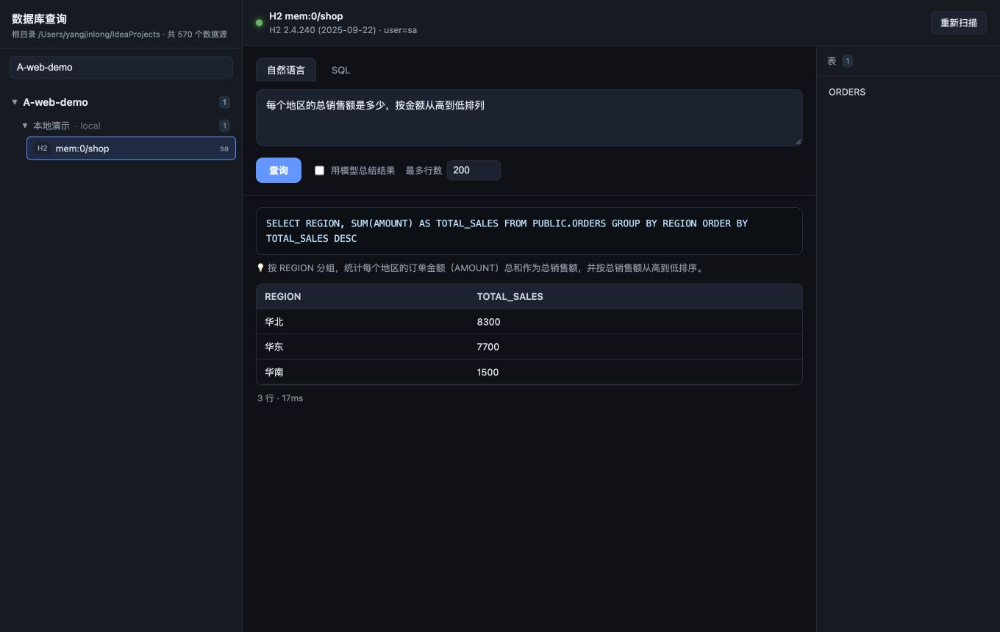

# dbquery · 跨项目数据库自然语言查询工具

扫描本机所有 Java 项目里的数据库配置，按 **项目 → 配置文件/环境 → 数据源** 罗列，
选中一个数据源后，用**自然语言**查询它（自动翻译成 SQL 并执行）。

- 数据源发现：解析每个项目下的 `application*.yml / *.properties / bootstrap*`，抽取全部 JDBC 数据源。
- 执行引擎：内置 **Java JDBC 桥**（`bridge/JdbcBridge.java`），驱动直接从本机 `~/.m2/repository` 加载，
  支持 **MySQL、达梦 DM、Oracle、PostgreSQL、Hive、SQLServer、H2**，无需额外安装 Python 驱动。
- 自然语言：调用 OpenAI 兼容接口（默认自动读取 `~/.codex/config.toml` 里的端点）把中文转成对应方言的 SQL。


## Web 界面（推荐）

```bash
./start.sh            # 启动，默认 http://127.0.0.1:8777
./start.sh 9000       # 指定端口
```

打开浏览器访问后：
- 左侧树按 **项目 → 配置/环境 → 数据源** 罗列，支持搜索（输入关键词自动展开匹配项）。
- 点击某个数据源即连接，右侧「表」面板可浏览表和字段结构；面板顶部有 **schema 下拉**，可切换 schema（默认取连接串里的 schema，如 `?schema=XXX`）。
- 主区域有两个页签：**自然语言**（输入中文自动转 SQL 并执行）和 **SQL**（直接执行）。
- 勾选「用模型总结结果」可在出表后额外给一段中文结论。

效果（示例库）：



## 环境要求
- Python 3.10+（依赖 `requests`、`PyYAML`）
- JDK 8+（已在本机 `~/.m2` 里有的 JDBC 驱动即可）

## 快速开始

```bash
cd ~/workProjects/personal-workbench/services/db-query

# 1) 罗列所有数据源（按项目/配置分组）
python3 dbquery.py list

# 2) 交互式：选项目 → 选配置 → 选数据源 → 进入自然语言查询
python3 dbquery.py

# 3) 一步到位：直接对某个数据源自然语言查询
python3 dbquery.py query "查询每个部门有多少用户，按人数降序" --project indexSystem --profile fat

# 4) 直接执行原始 SQL
python3 dbquery.py sql "SELECT COUNT(*) FROM user_info" --id 2ad6f9fb

# 5) 只看某类库 / 导出目录 JSON
python3 dbquery.py list --type dm
python3 dbquery.py catalog > catalog.json
```

### 交互模式内的命令
在 `db>` 提示符下：

| 输入 | 作用 |
| --- | --- |
| 任意中文/自然语言 | 转成 SQL 并执行 |
| `SELECT ...` 等 SQL | 直接执行原始 SQL（首词是 select/with/show/desc 等时识别） |
| `:tables` | 列出当前库所有表 |
| `:schema 表名` | 查看表字段 |
| `:sql <SQL>` | 强制执行原始 SQL |
| `:meta` | 重新加载表结构 |
| `:switch` | 换一个数据源 |
| `:exit` | 退出 |

## 配置 `config.json`
```json
{
  "projects_root": "/Users/yangjinlong/IdeaProjects",  // 扫描根目录，可换成别处
  "max_rows": 200,                                     // 单次查询最多返回行数
  "explain": false,                                    // 是否额外让模型总结结果
  "extra_classpath": [],                               // 额外的驱动 jar 目录/文件
  "exclude_dirs": ["target", "node_modules", ".git"],
  "llm": null                                          // 留空则自动读取 ~/.codex/config.toml / 环境变量
}
```

自定义 LLM 端点（覆盖自动探测）：
```json
"llm": { "base_url": "https://.../compatible-mode/v1", "api_key": "sk-...", "model": "deepseek-v4.1-flash" }
```
也可用环境变量：`OPENAI_BASE_URL` / `OPENAI_API_KEY` / `DBQUERY_LLM_MODEL`。

## 目录结构
```
dbquery.py            # 命令行入口
dbquery/              # Python 包
  catalog.py          # 扫描并解析数据库配置
  jdbc.py             # 驱动类路径解析 + Java 桥客户端
  llm.py              # 自然语言 -> SQL
  main.py             # CLI / 交互逻辑
  config.py           # 配置加载
bridge/JdbcBridge.java# 常驻 JDBC 执行桥（含极简 JSON 编解码）
config.json           # 用户配置
catalog.json          # 扫描结果缓存（自动生成）
server.py             # 本地 Web 服务（目录 + 查询 API）
start.sh              # 一键启动 Web 界面
web/index.html        # 单页前端
docs/                 # 截图等
```

## 重新编译 Java 桥（改过 JdbcBridge.java 后）
```bash
cd bridge && javac -d classes JdbcBridge.java
```

## 说明
- 内网/生产库能否连通取决于你本机网络（VPN/跳板）。工具只负责发起连接，连不上会给出明确报错。
- 驱动缺失时，在 `config.json` 的 `extra_classpath` 里补上对应 jar 即可。
- 列表明细默认按连接串里配置的 schema 过滤（达梦/Oracle/PG 尤其重要），避免把库里其它 schema 的表混进来。
- 支持 Spring/Docker 占位符：`${VAR:default}`、`${VAR:-default}` 会取默认值解析；没有默认值的会标记 `⚠含未解析占位符`。
- 数据源来自配置文件里真实的 JDBC 连接串；**没有数据库配置的项目**（如纯前端）会在 `list` 与网页侧栏底部单独列出。
